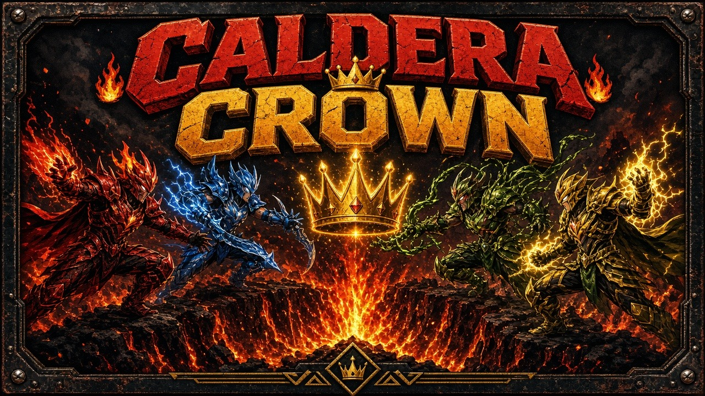

# Caldera Crown

King of the hill on a volcano rim while the lava climbs. Four rivals share one screen. Stand alone in the crown to score. Shove everyone else downhill.

## Launch

The game is static HTML, JavaScript, and CSS. A tiny Python 3 server hosts it on `127.0.0.1` at port **8816** (or the next free port) and opens a browser.

- macOS: double-click `launch-mac.command`
- Windows: double-click `launch-windows.bat`
- Linux: `./launch-linux.sh`
- Or run `python3 server.py` yourself

If Python 3 is missing, the launcher says so instead of failing silently. Pass `--no-browser` to serve without opening a window, or `--port` to prefer a different port.

## Controls

Keyboard works with no gamepads. A connected pad overrides that seat (pads 0–3 are P1–P4) and can be plugged in mid-match. Remap every key from Settings; the map is stored in `localStorage`.

| Player | Move | Shove | Hop / dodge |
| --- | --- | --- | --- |
| P1 | W A S D | F | G |
| P2 | Arrow keys | / | . |
| P3 | I J K L | ; | ' |
| P4 | Numpad 8 4 5 6 | Numpad 0 | Numpad Enter |
| Gamepad | Left stick or D-pad | A | B |

Start (gamepad) or Esc pauses. M mutes. Enter / Start confirms menus.

Empty join slots are bots, so one person can play. Press a seat's shove key to take it over, or 1–4 to toggle that empty seat between bot and off.

## Rules

The arena is a top-down volcano of five terraces. The summit is the crown.

- **Shove** knocks a nearby rival outward. A hard hit drops them a terrace. Off the outer rim, they fall into the lava.
- **Hop** jumps to the next terrace up. On the summit it is a short dodge.
- Standing **alone** in the crown scores **1 point per second**. Two or more rivals in the zone contest it, and nobody scores.
- Every **20 seconds** the lava floods the lowest terrace that is still safe. Touch lava and you sit out for **3 seconds**, respawn on a safe edge, and lose **3 points** (the score never goes below zero).
- Lava bombs land on a telegraphed circle and **stun** anyone they catch.
- In the **final 30 seconds** the crown shrinks toward the center.
- A round lasts **120 seconds** or until someone reaches **60 points**. Highest score wins the round. Ties go to whoever held the crown longer, then to the lower seat number.
- First to **2 round wins** takes the match (best of 3). Settings can change that to first to 1 or 3.

## Arcade manifest

`arcade.json` describes the cabinet: name, id, icon, cover, per-OS launchers, web entry, 4 players, minimum 1, keyboard and gamepad input, port 8816, version 1.0.0.

## Tests

Core rules live in `src/core/` with no DOM, so Node can run them directly. There are no packages to install.

```bash
node --test tests/
python3 tests/test_server.py
```

`npm test` runs both. GitHub Actions does the same on every push and pull request.

The suite covers movement and collision, scoring, round and match wins, lava elimination and respawn, shove, hop, lava bombs, the shrinking crown, seeded RNG determinism, keyboard and gamepad mapping, the arcade manifest, and a smoke check that `server.py` serves `index.html`.

## License

[MIT](LICENSE)
